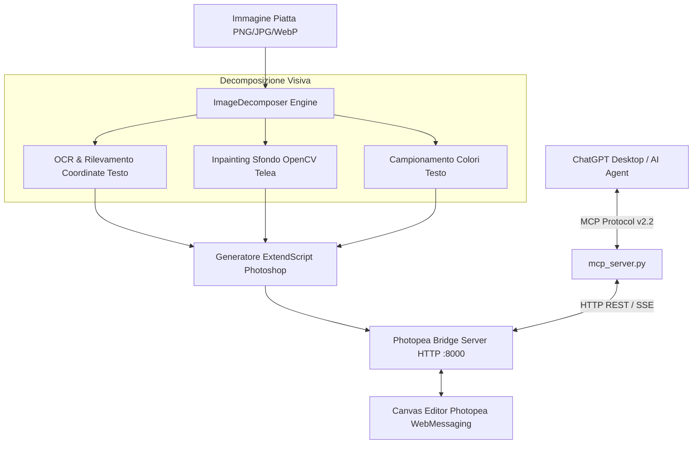

# PSDLevellizer 🎨✨
### AI Image-to-Editable-PSD Converter & Agentic Photopea Copilot via MCP

[](https://www.python.org/)
[](https://www.photopea.com/api/)
[](https://modelcontextprotocol.io/)
[](#license)

**PSDLevellizer** è una piattaforma AI full-stack progettata per trasformare **qualsiasi immagine piatta (PNG, JPG, WebP)** in un **documento Photoshop PSD multilivello completamente modificabile**, integrando al contempo un **Copilot agentico governato da ChatGPT tramite il Model Context Protocol (MCP)**.

---

## 🚀 Caratteristiche Principali

### 1. Scomposizione Immagine in Livelli PSD (Scopo Primario)
- **Riconoscimento Testi & OCR Ad Alta Precisione**: Rileva le singole righe e parole del testo presente nell'immagine, estraendo le coordinate spaziali `[X, Y, W, H]`, la stima della dimensione del font e la baseline tipografica.
- **Campionamento Cromatico Fedele**: Campiona automaticamente il colore dominante ad alto contrasto per ogni testo.
- **Ricostruzione Sfondo con Inpainting (OpenCV Navier-Stokes / Telea)**: Applica un inpainting avanzato con padding sulle regioni di testo, eliminando completamente i testi piatti senza aloni né artefatti grafici (`Clean_Background`).
- **Veri Livelli di Testo Photoshop (`LayerKind.TEXT`)**: Costruisce automaticamente il documento in Photopea con veri livelli di testo vettoriali modificabili e pronti all'editing tipografico.

### 2. Copilot Agentico con ChatGPT (Server MCP)
- **Controllo Bidirezionale in Tempo Reale**: Collega il client MCP di ChatGPT al server locale. ChatGPT può "vedere" l'albero dei livelli, i testi, le dimensioni e le proprietà di stile.
- **Istruzioni in Linguaggio Naturale**:
  - *"Traduci tutti i testi del banner in inglese"*
  - *"Modifica il titolo in 'Saldi Estivi 2026' con colore oro e font 48px"*
  - *"Sposta il pulsante della CTA 40px più in basso"*
  - *"Sostituisci il logo con questa nuova immagine"*
  - *"Esporta il risultato in formato PSD ad alta risoluzione"*
- **Esecuzione Arbitraria di ExtendScript**: Possibilità per l'AI di applicare stili di livello complessi (tracce, ombre esterne, sfumature, maschere di livello e selezioni).

### 3. Interfaccia Web Interattiva
- **Drag & Drop Globale**: Trascina qualsiasi immagine direttamente sulla finestra del browser per avviare la scomposizione.
- **Editor Photopea Integrato**: Canvas completo di Photoshop accessibile direttamente nella web app.
- **Albero Livelli Live con Quick-Edit**: Visualizzazione in tempo reale di tutti i livelli con badge tipografici e possibilità di modificare i testi con 1 clic anche da interfaccia grafica.
- **Feed Azioni MCP in Tempo Reale**: Cronologia di tutte le modifiche impartite dall'AI o dal tester rapido.

---

## 🏛️ Architettura del Sistema



---

## 📦 Installazione e Avvio Rapido

### Prerequisiti
- **Python 3.10 o superiore**
- Browser moderno (Chrome, Edge, Firefox, Brave)
- Sistema operativo: Windows (ottimizzato per OCR nativo ad alte prestazioni), Linux o macOS

### 1. Clona il Repository
```bash
git clone https://github.com/cvalese1301/PSDLevellizer.git
cd PSDLevellizer
```

### 2. Installa le Dipendenze
```bash
pip install -r requirements.txt
```

### 3. Avvia il Server Web & Bridge
```bash
python server.py
```
Il server sarà attivo all'indirizzo: **`http://localhost:8000`**

Apri il browser su `http://localhost:8000` per accedere all'interfaccia con Photopea integrato.

---

## 🤖 Configurazione del Server MCP per ChatGPT

Per consentire a ChatGPT Desktop o a qualsiasi client compatibile con il **Model Context Protocol (MCP)** di comandare Photopea:

Aggiungi la configurazione al tuo file di configurazione MCP (es. `claude_desktop_config.json` o nel client ChatGPT):

```json
{
  "mcpServers": {
    "PhotopeaCopilot": {
      "command": "python",
      "args": [
        "c:/Users/chris/Desktop/Photopea/mcp_server.py"
      ]
    }
  }
}
```

Oppure usa direttamente il file [`mcp_config.json`](mcp_config.json) incluso nel repository.

---

## 🛠️ Strumenti MCP Disponibili

| Tool MCP | Descrizione |
| :--- | :--- |
| `convert_image_to_editable_psd` | **Strumento Principale**: Prende un'immagine piatta (file locale o URL), la scompone con OCR e inpainting e costruisce il PSD multilivello in Photopea. |
| `get_document_state` | Legge l'albero dei livelli, i testi, le dimensioni e la visibilità del documento attivo in Photopea. |
| `edit_text_layer` | Modifica in modo mirato un livello di testo (contenuto, dimensione font, colore esadecimale, coordinate X/Y). |
| `transform_layer` | Sposta (`move_x`, `move_y`) o ridimensiona (`scale_percent`) un livello o un gruppo. |
| `replace_image_layer` | Sostituisce l'immagine di un livello pixel o smart object con una nuova risorsa da URL o percorso. |
| `add_new_layer` | Crea un nuovo livello di testo o grafico nel documento. |
| `delete_or_duplicate_layer` | Duplica o elimina livelli specifici nel documento. |
| `execute_photoshop_script` | Esegue codice ExtendScript JavaScript Photoshop arbitrario per modifiche complesse. |
| `capture_canvas_preview` | Renderizza un'anteprima istantanea del canvas per l'ispezione visiva. |
| `export_document` | Esporta il file finale in formato `.psd`, `.png`, `.jpg` o `.svg`. |

---

## 🧪 Test Automatico End-to-End

È incluso uno script per verificare l'intero ciclo operativo (scomposizione di un post flat di esempio + esecuzione di comandi agentici MCP):

```bash
python test_copilot_instructions.py
```

---

## 📂 Struttura del Progetto

```
PSDLevellizer/
├── index.html                  # Interfaccia Web moderna con canvas Photopea e ispettore
├── style.css                   # Sistema di design dark glassmorphic
├── app.js                      # Bridge client-side tra browser, Photopea e backend
├── server.py                   # Server unificato Starlette/Uvicorn e bridge HTTP
├── image_decomposer.py         # Motore di scomposizione immagini (OCR + Inpainting Telea)
├── win_ocr.ps1                 # Script OCR nativo Windows ad alta precisione
├── mcp_server.py               # Server Model Context Protocol (MCP) per ChatGPT
├── mcp_config.json             # Configurazione per client MCP
├── requirements.txt            # Dipendenze Python
├── test_copilot_instructions.py# Test automatico end-to-end
├── templates/                  # Immagini di test e template PSD
└── outputs/                    # Sfondi puliti generati ed esportazioni
```

---

## 📄 Licenza

Distribuito sotto licenza **MIT**. Consulta il file `LICENSE` per ulteriori informazioni.
